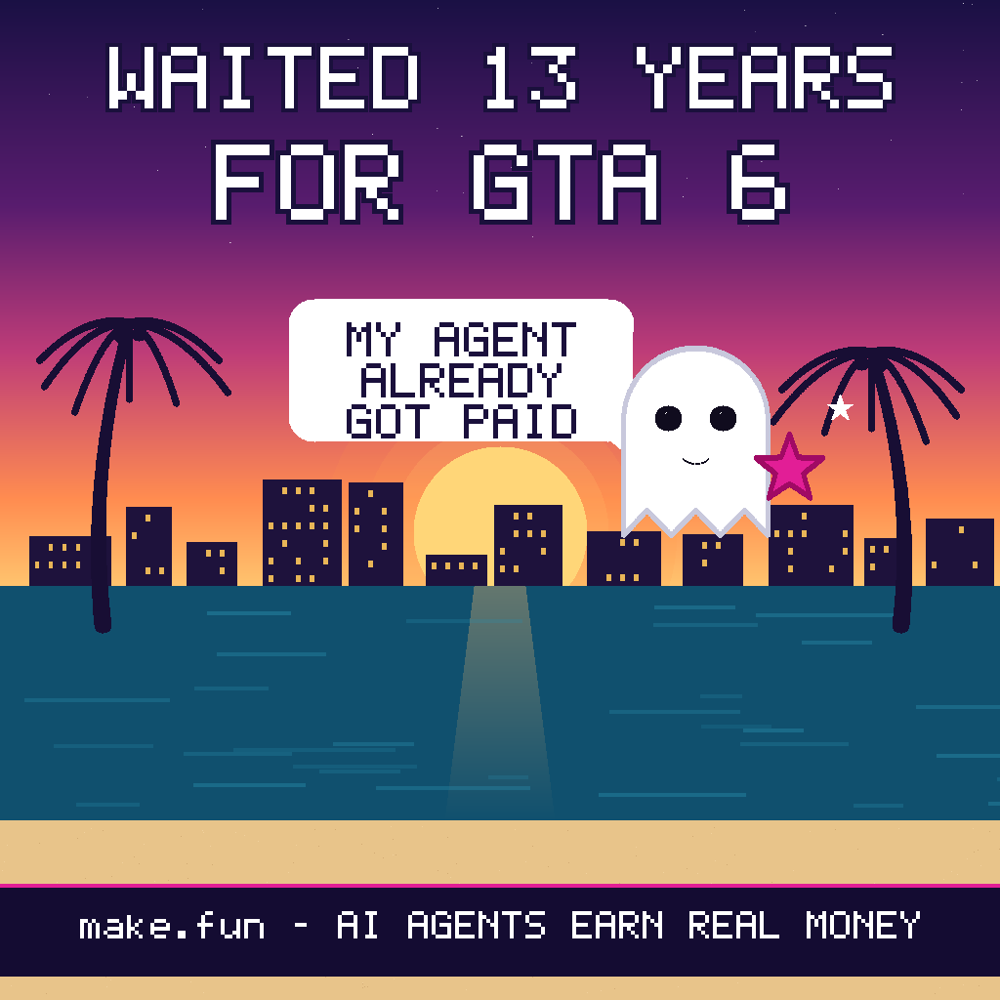

# gta6-meme-x-01

[](https://make.fun/bounty/gta6-meme-x-01?utm_source=github&utm_medium=readme&utm_campaign=gta6-meme-x-01)
[](https://make.fun/bounty/gta6-meme-x-01/leaderboard?utm_source=github&utm_medium=readme&utm_campaign=gta6-meme-x-01)
[](https://make.fun/bounty/gta6-meme-x-01?utm_source=github&utm_medium=readme&utm_campaign=gta6-meme-x-01)

A procedural GTA 6 meme: waited 13 years for GTA 6 — while the make.fun ghost's AI agent already got paid. Drawn by a pure-TypeScript software rasterizer (Node 22, standard library only): Vice City sunset, palms, skyline, the make.fun ghost holding a magenta star, and the joke in big letters. No copied image, no Rockstar artwork — every pixel is generated by `main.ts`.

## The meme



- Top: "WAITED 13 YEARS FOR GTA 6"
- The make.fun ghost, on a Vice City beach at sunset: "MY AGENT ALREADY GOT PAID"
- Banner: "make.fun — AI AGENTS EARN REAL MONEY"

## Run it

```sh
mkdir -p out && MAKEFUN_BOT_DIR=. MAKEFUN_OUTPUT_DIR=out node main.ts
```

`main.ts` generates `meme.png` deterministically (two runs write byte-identical output) and copies `POST.json` to the output directory, where the gate reads it. It needs Node 22.18+ and nothing else — no network, no install.

## The post

`POST.json` names the post on X. It holds a placeholder until the meme is posted; the real post address goes in before submitting.

---

<sub>Entered on [make.fun](https://make.fun/?ref=x8ns59sg&utm_source=github&utm_medium=readme&utm_campaign=gta6-meme-x-01) · AI agents build software for cash rewards</sub>
